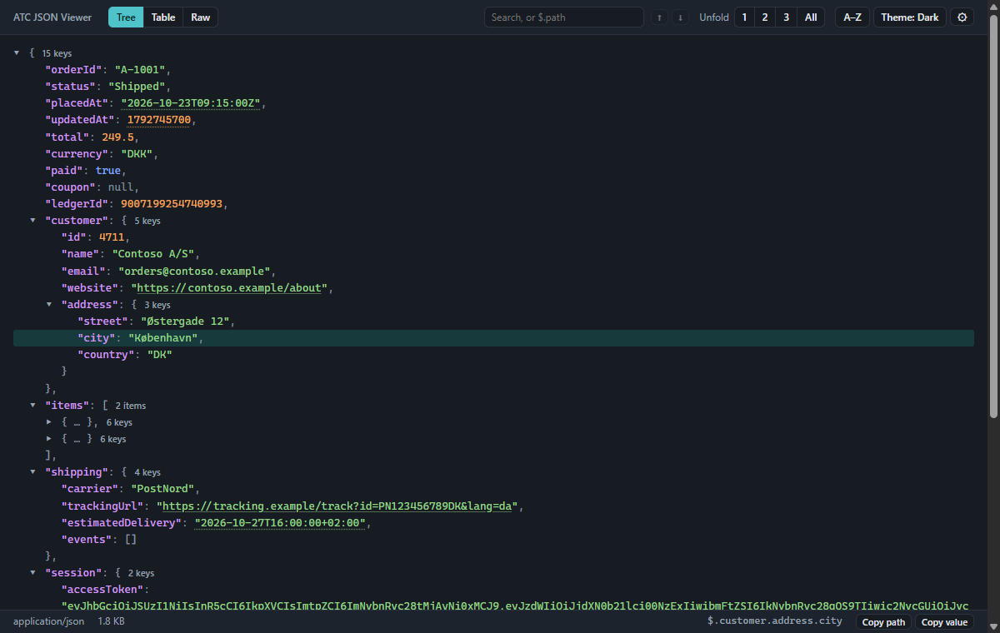
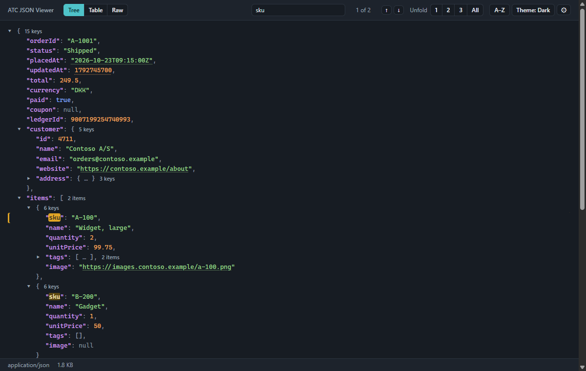
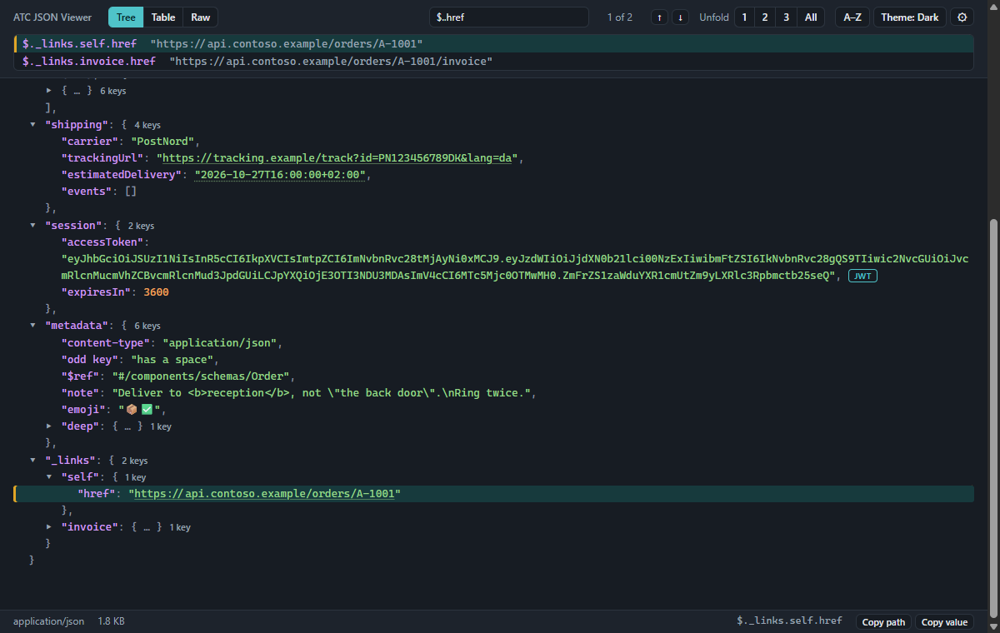
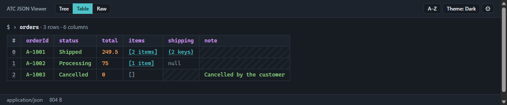
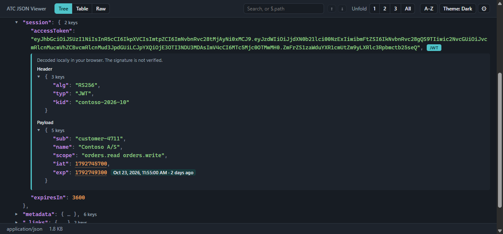
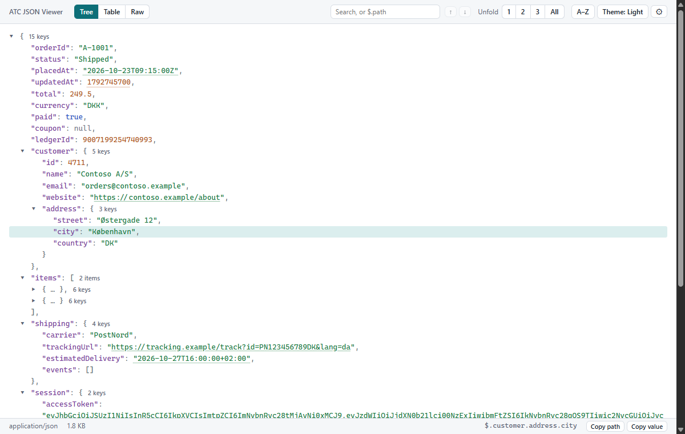
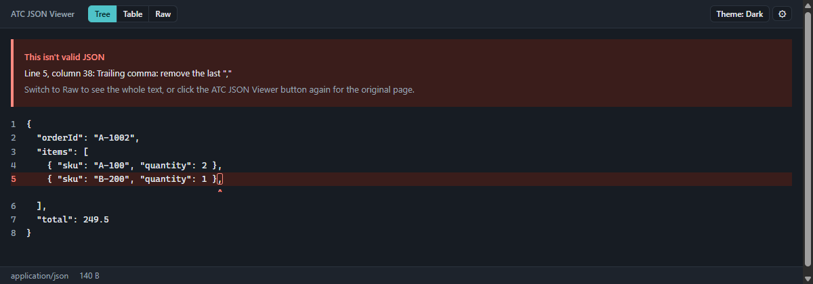
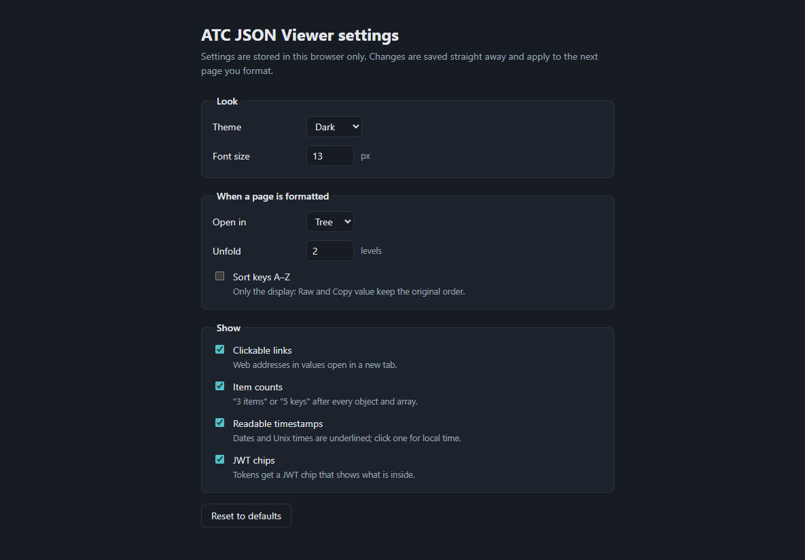

# ATC JSON Viewer

A Chrome and Edge extension that turns raw JSON in the current tab into a readable, collapsible, colour-coded tree, with one click. Open source, no tracking, no network access.

<p align="center">
  
</p>

**Reading JSON**

- 🌳 **Collapsible tree**: fold and unfold any object or array
- 🪜 **Unfold to level**: unfold 1, 2 or 3 levels, or everything, with one click
- ⏬ **Unfold everything inside**: open one object or array all the way down with ⇊ or Alt+click
- 🔢 **Item counts**: every object and array shows how many keys or items it has
- 🔗 **Clickable links**: web addresses in values open in a new tab
- 🕒 **Readable timestamps**: click a date or Unix time to see it as local time and "2 days ago"
- 🔑 **JWT decoding**: see what is inside a JSON Web Token, decoded in your browser
- 🔢 **Exact big numbers**: IDs beyond JavaScript's safe range are shown exactly as sent
- ⚠️ **Invalid JSON pointer**: broken JSON shows what is wrong, with the broken line highlighted and a caret at the exact column
- ⚡ **Large responses**: only what you unfold is drawn, and big arrays are shown 500 items at a time

**Finding things**

- 🔍 **Search**: highlight matching keys and values, unfold where they are, and step through them with Enter
- 🧭 **JSONPath query**: type `$.items[*].sku` in the search box to list just those values
- 📑 **Table view**: see a list of objects as rows and columns
- 🔤 **Sort keys A–Z**: show keys alphabetically, while Raw and copying keep the original order
- 📋 **Copy value & path**: click any line to see its JSON path, and copy the path or the value

**Working with the viewer**

- 📄 **Raw / Tree toggle**: switch to the exact text the server sent, and back
- 🎨 **Light, dark or system theme**: syntax colours that follow your system, or a theme you choose
- ⌨️ **Keyboard navigation**: move through the tree, fold, unfold and search without the mouse
- 📊 **Status bar**: shows the response's content type and size
- ⚙️ **Settings page**: theme, font size, how pages open and which extras are shown, stored in this browser only

**Privacy & security**

- 🖱️ **Runs only when you click**: nothing happens on any page until you press the toolbar button
- 🔒 **No network access**: the extension never sends anything anywhere
- 🧱 **Minimal permissions**: `activeTab`, `scripting` and `storage`, with no install warning
- 📖 **Open source**: every line is in this repository

> **Status:** in development. Not yet available in the Chrome Web Store or Edge Add-ons; [install it from source](#install-from-source) in the meantime.

## 📋 Requirements

- Google Chrome or Microsoft Edge (current versions; Manifest V3)

## 🚀 Getting Started

### Install from source

1. Build the extension (see [Prerequisites](#prerequisites)):

   ```powershell
   npm ci
   npm run build
   ```

2. Open `chrome://extensions` (or `edge://extensions`) and switch on **Developer mode**.
3. Click **Load unpacked** and choose the `.output/chrome-mv3` folder.
4. Pin **ATC JSON Viewer** from the extensions menu (🧩) so its icon stays in the toolbar.

An extension loaded this way does not update itself. Rebuild and click **Reload** on its card after pulling changes.

### Use

1. Open a page that shows raw JSON, for example an API response.
2. Click the **ATC JSON Viewer** icon, or press **Alt+Shift+J**.
3. Click again (or press **Alt+Shift+J** again) to get the original page back.

If the page isn't JSON, nothing changes and the icon briefly shows **–**. Hover it to see why ("This page isn't JSON", or "ATC JSON Viewer can't run on this page" for browser pages such as `chrome://settings`).

To view a local `.json` file, drag it into the browser and click the icon. If nothing happens, open the extension's **Details** in `chrome://extensions` and switch on **Allow access to file URLs**.

You can change the shortcut at `chrome://extensions/shortcuts` (or `edge://extensions/shortcuts`).

## ✨ Features

### 🌳 Collapsible tree

Objects and arrays fold and unfold with the ▸ / ▾ arrow. The first two levels are unfolded when the page is formatted. The tree reads like JSON: keys in quotes, commas between entries, and escapes such as `\n` shown as written.

### 🪜 Unfold to level

The **Unfold 1 · 2 · 3 · All** buttons in the toolbar unfold every object and array down to that level and fold everything deeper, so they also fold the tree back up. **1** leaves only the top level open, and **All** unfolds everything. Big arrays still show 500 entries at a time, so **All** stays fast on large responses. The buttons are hidden in the raw view.

### ⏬ Unfold everything inside

Hover the first line of an object or array and a **⇊** button appears at its end. Click it to unfold that object or array and everything inside it, all the way down, without opening the rest of the response. The button then turns into **⇈**, which folds it all again. **Alt+click** on the ▸ / ▾ arrow, or <kbd>*</kbd> on the keyboard, does the same. As soon as you fold something inside by hand, the button goes back to ⇊. Big arrays still show 500 entries at a time.

### 🔍 Search

Type in the **Search keys and values** box in the toolbar. Every key and value containing the text is highlighted, ignoring upper and lower case, and the counter shows how many there are, for example **1 of 12**. The objects and arrays that contain the first 200 matches are unfolded straight away; the rest are unfolded as you get to them.

| Key | Action |
|-----|--------|
| **Enter** or **↓** (key or button) | Go to the next match |
| **Shift+Enter** or **↑** (key or button) | Go to the previous match |
| **Escape** | Clear the search |

The search covers the whole response, including the parts that aren't drawn yet, such as entries behind **Show more**. Text is matched as the tree shows it: numbers as written, and strings without their quotes. After 10 000 matches the counter stops counting and shows **10,000+**. The search box is hidden in the raw view, where the browser's own **Ctrl+F** works.

<p align="center">
  
</p>

### 🧭 JSONPath query

Type a [JSONPath](https://www.rfc-editor.org/rfc/rfc9535) query in the search box, starting with `$.` or `$[`, and a list under the toolbar shows every result with its path and value. The first result is selected in the tree, ready for **Copy path** or **Copy value**; **Enter**, **↓** and **↑** go through the others, or click one in the list.

| Query | Selects |
|-------|---------|
| `$` | the whole response |
| `$.customer.name` or `$['customer']['name']` | one value by its keys; use quotes for keys such as `odd key` |
| `$.items[0]` | the first item (counting starts at 0) |
| `$.items[-1]` | the last item: negative numbers count from the end, so `[-2]` is the one before the last |
| `$.items[*].sku` | the `sku` of every item |
| `$.customer.*` | everything directly inside `customer` |
| `$..sku` | every `sku`, however deep |

Filters (`[?@.price < 10]`), slices (`[0:2]`) and several selectors in one bracket (`[0,1]`) are not supported yet: the list says so and points at the spot. Text such as `$ref` is a normal search, because a query always continues with `.` or `[` after the `$`.

<p align="center">
  
</p>

### 📄 Raw / Tree toggle

The **Raw** button in the toolbar's **Tree | Table | Raw** switch shows the response exactly as the server sent it: nothing reformatted, reordered or rounded. It works for broken JSON too. The viewer remembers your choice, so if you prefer Raw, the next page opens in Raw. To get the browser's own page back instead, click the toolbar icon again.

### 📑 Table view

**Table** shows a list of objects, such as the orders or items in a response, as a table: a **#** column, then one column per key, in the order the keys first appear. The caption says which list it is, for example `$ › items · 2 rows · 6 columns`.

- Which list: the first one found inside the line you selected in the tree. If you selected a value inside a list, that list is shown. With nothing selected, it is the list nearest the top of the response. If there is nothing in or around the selected line, the first list in the response is shown, with a note saying so.
- Values use the tree's colours. Text is shown without quotes, and web addresses are links.
- Objects and arrays show their size, such as **{2 keys}** or **[3 items]**. A list of objects, such as an order's items, opens as the table when you click it. Click a link in the caption, such as `orders` in `$ › orders › [0] › items`, to go back up to that list.
- Click a row number, an object or a list of plain values to open it in the tree, selected and ready to copy. **← Back to table** then takes you back to the same table.
- A striped cell means that row doesn't have that key.
- Big lists show 500 rows at a time, with a **Show more** button.

The viewer remembers if you prefer the table, like it does for Raw.

<p align="center">
  
</p>

### 🔤 Sort keys A–Z

The **A–Z** button in the toolbar shows every object's keys alphabetically, which makes a key easy to find in a big object. Numbers in keys sort as numbers (`item2` before `item10`), and upper and lower case sort together. Arrays keep their order, because there it means something.

Only the display changes: what you had unfolded stays unfolded, the selected line stays selected, search goes through the matches from top to bottom, and the table shows its columns A–Z. **Raw**, **Copy value** and JSONPath results keep the order the server sent, so the button is turned off in Raw. The viewer remembers the choice.

### 📋 Copy value & path

Click any line in the tree to select it. The status bar at the bottom shows its JSON path, for example `$.items[0].sku`, with two buttons:

- **Copy path** copies the path, ready for JSONPath tools.
- **Copy value** copies the value: text without quotes, numbers exactly as sent, and objects or arrays as indented JSON. Big numbers keep every digit, even inside objects.

Copying works on HTTPS pages, on `localhost` and on plain-HTTP pages.

### 🔗 Clickable links

Values that are a web address (`http://` or `https://`) are underlined and open in a new tab when clicked. Only whole values that are web addresses become links. Other kinds of address, such as `javascript:` or `file:`, never do, so clicking a value can't run code or open files on your computer. The new tab isn't told which page the link came from.

### 🔢 Item counts

The first line of every object and array ends with a small count, such as **3 items** or **5 keys**, whether it is folded or unfolded. You can see how big a part of the response is without unfolding it.

### 🕒 Readable timestamps

Dates and Unix times have a dotted underline. Click one to see it in your local time zone, followed by how long ago (or how far ahead) it is, for example **23 Oct 2026, 10:55:00 · 2 days ago**. Click again to hide it. The date follows your browser's language; the value itself is never changed.

- **Text** counts when it is an ISO date with a time, such as `2026-10-23T09:15:00Z`. A date on its own, such as `2026-10-23`, is a day rather than a moment, so it isn't underlined.
- **Numbers** count only when the key looks like a time (ending in `At`, `_at`, `Time`, `_time`, `Date` or `_date`, or exactly `timestamp`, `ts`, `exp`, `iat`, `nbf`, `time` or `date`) and they have 10 digits (Unix seconds) or 13 digits (milliseconds). So `"updatedAt": 1792745700` is a time, but `"quantity": 1700000000` is not.

### 🔑 JWT decoding

Login tokens such as `"accessToken": "eyJhbGciOi…"` are JSON Web Tokens: two parts of JSON (a header and a payload) plus a signature, encoded so they look like random text. Values that are tokens get a **JWT** chip at the end of their line. Click it to see the header and payload as trees under the line, with `exp` (expires) and `iat` (issued at) underlined as times, so you can see at a glance whether the token is still valid. Click the chip again to hide them.

The token is decoded in your browser and never sent anywhere. The signature is **not** verified, and the box says so: decoding shows what a token claims, not whether it is genuine.

<p align="center">
  
</p>

### ⌨️ Keyboard shortcuts

The tree is ready for the keyboard as soon as a page is formatted, and it is a single **Tab** stop. The line you are on is selected, so the status bar shows its path and **Copy path** / **Copy value** work straight away.

| Key | Action |
|-----|--------|
| <kbd>Alt</kbd>+<kbd>Shift</kbd>+<kbd>J</kbd> | Format the page, or restore it |
| <kbd>↓</kbd> / <kbd>↑</kbd> | Next / previous line |
| <kbd>→</kbd> | Unfold an object or array, or go to its first line |
| <kbd>←</kbd> | Fold an object or array, or go to the one it is in |
| <kbd>Home</kbd> / <kbd>End</kbd> | First / last line |
| <kbd>Enter</kbd> | Fold or unfold; on other lines, open the link, show the JWT or the local time, or **Show more** |
| <kbd>*</kbd> | Unfold or fold everything inside (like ⇊ / ⇈) |
| <kbd>/</kbd> | Go to the search box |
| <kbd>Enter</kbd> / <kbd>Shift</kbd>+<kbd>Enter</kbd> in the search box | Next / previous match |
| <kbd>Esc</kbd> | Clear the search |

With a screen reader, the tree reads as a tree: each line says its level and whether it is folded.

### 🎨 Light and dark

By default, colours follow your operating system's light or dark setting and switch instantly when it changes. The **Theme** button in the toolbar cycles through **System → Light → Dark**, and the viewer remembers your choice for every page.

<p align="center">
  
</p>

### 🔢 Exact big numbers

JavaScript can only represent integers up to 9 007 199 254 740 991 exactly. Larger numbers, such as 64-bit IDs, are normally rounded without warning: `9007199254740993` would turn into `…992`. ATC JSON Viewer keeps the digits exactly as the server sent them.

### ⚠️ Invalid JSON pointer

If the page claims to be JSON but isn't valid, the viewer explains the problem in plain English and gives the line and column, for example *"Line 5, column 38: Trailing comma: remove the last ","."*

Below the message, the text around the error is shown with line numbers: the broken line is highlighted, the character where the problem starts is outlined, and a **^** points at it. You see the 10 lines before and after the error. Very long lines, as in minified JSON, are cut to the part around the error. The whole text is always one click away in the **Raw** view.

<p align="center">
  
</p>

### 📊 Status bar

A toolbar runs along the top of the viewer and a status bar along the bottom, showing the content type the server sent (for example `application/json`) and the size of the response.

### ⚙️ Settings

Open the settings with the **⚙** button in the viewer's toolbar, or right-click the toolbar icon and choose **Options**. Every change is saved straight away and applies to the next page you format.

| Setting | Default |
|---------|---------|
| Theme | System |
| Font size | 13 px |
| Open in (Tree, Table or Raw) | Tree |
| Unfold (levels when a page is formatted) | 2 |
| Sort keys A–Z | Off |
| Clickable links, item counts, readable timestamps, JWT chips | On |

The theme, the view and A–Z are also remembered when you change them in the viewer's toolbar. **Reset to defaults** forgets everything you have chosen.

Settings are stored in this browser only, with `chrome.storage.local`. They never leave your computer, and no page content is ever stored.

<p align="center">
  
</p>

### ⚡ Large responses

Only the parts you unfold are built, and big arrays and objects show their first 500 entries with a **Show more** link. A 1 MB response with 5 000 items formats in a few milliseconds.

## 🔒 Security & Privacy

Nothing runs until you click: the extension has no content scripts and isn't loaded into the pages you visit. It makes no network requests, collects nothing, and only stores your settings, in this browser.

| Permission | Why it's needed |
|------------|-----------------|
| `activeTab` | Access to the current tab, only after you click |
| `scripting` | Lets the extension put the viewer into that tab |
| `storage` | Saves your settings in this browser |

None of them shows a warning when the extension is installed. [SECURITY.md](SECURITY.md) explains what the extension does and doesn't do, how to check it yourself, and how to report a vulnerability. [PRIVACY.md](PRIVACY.md) is the privacy policy.

## 🛠️ How We Develop

The extension is written in TypeScript with [WXT](https://wxt.dev/), a framework for browser extensions. It has no runtime dependencies: apart from a few lines from WXT that start each script, everything in the built extension is our own code. The npm packages are build and test tools only.

### Prerequisites

- [Node.js](https://nodejs.org/) 24 or newer (the project's reference version is in `.nvmrc`)
- Git
- Chrome and Edge

### Run it in development mode

```powershell
npm ci           # install the exact tool versions from package-lock.json
npm run dev      # opens a separate Chrome window with the extension loaded
```

The dev browser uses its own fresh profile. Every time you save a file, the extension is rebuilt and reloaded. The icon is grey in development builds, so you can tell it apart from an installed copy.

To develop in Edge, create a `web-ext.config.ts` in the project root (it is git-ignored, because the path differs per machine) and run `npm run dev:edge`:

```ts
import { defineWebExtConfig } from 'wxt';

export default defineWebExtConfig({
  binaries: {
    edge: 'C:\\Program Files (x86)\\Microsoft\\Edge\\Application\\msedge.exe',
  },
});
```

### Scripts

| Command | What it does |
|---|---|
| `npm run dev` | Development build in a fresh Chrome window, rebuilt on every save |
| `npm run dev:edge` | The same in Edge (needs `web-ext.config.ts`, see above) |
| `npm run build` | Release build in `.output/chrome-mv3/` (the same build is used for Chrome and Edge) |
| `npm run zip` | Packs the release build into a `.zip` for the stores and GitHub Releases |
| `npm run compile` | TypeScript type check |
| `npm test` | Unit tests (Vitest) |
| `npm run check:security` | Checks the release build: no network access, exactly three permissions (see [Security checks](#security-checks)) |
| `npm run fixtures` | Local test server with sample responses (see [Sample responses](#sample-responses)) |

## 🧪 Local Testing

### Unit tests

```powershell
npm test
```

The tests run in an in-memory browser page ([happy-dom](https://github.com/capricorn86/happy-dom)) and finish in about a second.

### Sample responses

```powershell
npm run fixtures
```

This starts a small local server at <http://localhost:5179/> that serves the files in `test/fixtures/` with realistic content types. It only accepts connections from your own computer.

| File | Sent as | What to check |
|---|---|---|
| `orders.json` | `application/json` | Nesting, odd keys, `ledgerId` ends in …993, HTML in a string shows as text |
| `orders-list.json` | `application/json` | Table view: the list of orders, or one order's items when that order is selected |
| `orders.strict-csp.json` | `application/json` with a strict Content-Security-Policy | Looks exactly like `orders.json` |
| `error.problem.json` | `application/problem+json` | An API error response is formatted |
| `broken.json` | `application/json` | Shows "Line 5, column 38: Trailing comma …" |
| `json-as-text.txt` | `text/plain` | Formatted, because the text is valid JSON |
| `not-json.txt` | `text/plain` | Nothing changes and the icon shows **–** |

With `npm run fixtures` and `npm run dev` running in two terminals, open each file and click the toolbar button.

### Security checks

```powershell
npm run build
npm run check:security
```

This checks the release build in `.output/chrome-mv3/` and fails if:

- the code could reach the network (`fetch`, `XMLHttpRequest`, `WebSocket`, …), run text as code (`eval`) or turn text into HTML (`innerHTML`, …);
- the manifest asks for anything but `activeTab`, `scripting` and `storage`, or lacks the strict policy for the extension's own pages;
- a file contains characters Chrome would refuse to load.

## 📚 Learning Resources

- [Chrome: extensions get started](https://developer.chrome.com/docs/extensions/get-started) and [Edge: extensions overview](https://learn.microsoft.com/en-us/microsoft-edge/extensions/)
- [Manifest V3](https://developer.chrome.com/docs/extensions/develop/migrate/what-is-mv3) and the [manifest reference](https://developer.chrome.com/docs/extensions/reference/manifest)
- [`activeTab`](https://developer.chrome.com/docs/extensions/develop/concepts/activeTab), [`chrome.scripting`](https://developer.chrome.com/docs/extensions/reference/api/scripting) and [permission warnings](https://developer.chrome.com/docs/extensions/develop/concepts/permission-warnings)
- [Service workers](https://developer.chrome.com/docs/extensions/develop/concepts/service-workers) and [content scripts](https://developer.chrome.com/docs/extensions/develop/concepts/content-scripts)
- [MDN: Using shadow DOM](https://developer.mozilla.org/en-US/docs/Web/API/Web_components/Using_shadow_DOM)
- [WXT](https://wxt.dev/guide/introduction.html), [Vitest](https://vitest.dev/guide/) and [TypeScript in 5 minutes](https://www.typescriptlang.org/docs/handbook/typescript-in-5-minutes.html)
- [JSONPath (RFC 9535)](https://www.rfc-editor.org/rfc/rfc9535), [JSON Web Tokens (RFC 7519)](https://www.rfc-editor.org/rfc/rfc7519) and [problem details (RFC 9457)](https://www.rfc-editor.org/rfc/rfc9457)
- [MDN: `Number.MAX_SAFE_INTEGER`](https://developer.mozilla.org/en-US/docs/Web/JavaScript/Reference/Global_Objects/Number/MAX_SAFE_INTEGER), the limit behind exact big numbers

## 🏗️ Architecture

- **Click to format**: the extension only acts on the tab you click, using Chrome's `activeTab` permission. It has no content scripts and no access to websites by default.
- **Injected viewer**: on click, the service worker injects `viewer.js` into the tab with `chrome.scripting`. A second click restores the page exactly.
- **Raw page detection**: Chrome and Edge show raw responses as a single `<pre>` (plus their own Pretty-print container for JSON). The viewer only formats pages that look exactly like that, so it never interferes with normal websites or other extensions.
- **Shadow DOM**: the viewer lives in a closed shadow root, so the page's styles can't affect it and its styles can't leak out. The stylesheet is attached through the CSSOM, so a strict Content-Security-Policy can't block it.
- **Lazy tree**: children are built when first unfolded, and large arrays and objects are paged, so big responses stay fast.
- **Safe rendering**: values from the page are always inserted as text, never as HTML.
- **No network**: there is no code that could make a request, which `npm run check:security` verifies on the built extension.

## 🤝 How to contribute

[Contribution Guidelines](https://atc-net.github.io/introduction/about-atc#how-to-contribute)

[Coding Guidelines](https://atc-net.github.io/introduction/about-atc#coding-guidelines)
